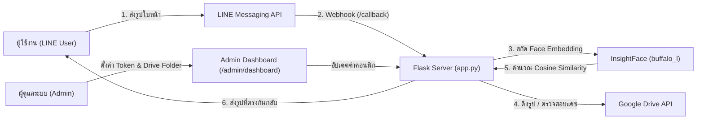

# ระบบค้นหารูปภาพอัตโนมัติด้วย AI จดจำใบหน้าผ่าน LINE Official Account (AI-Powered Photo Retrieval LINE Bot)

ระบบแชตบอตบน **LINE Official Account (LINE OA)** ที่ผสานโมเดลปัญญาประดิษฐ์ **InsightFace (`buffalo_l`)** เข้ากับ **Google Drive API** เพื่อช่วยให้ผู้ใช้งานสามารถส่งรูปถ่ายใบหน้าของตนเองผ่านแชต LINE และให้ระบบค้นหารูปภาพทั้งหมดที่มีใบหน้าตรงกันจากคลังภาพบน Google Drive ส่งกลับมาให้อัตโนมัติ พร้อมหน้าเว็บ **Admin Control Dashboard** สำหรับจัดการ API Token และการตั้งค่าระบบ

---

## จุดเด่นของระบบ (Key Features)

- **AI Face Recognition ความแม่นยำสูง**: สกัดจุดสำคัญบนใบหน้า (Face Embeddings) ด้วยโมเดล `InsightFace (buffalo_l)` และเปรียบเทียบความคล้ายคลึงด้วย **Cosine Similarity**
- **เชื่อมต่อ Google Drive อัตโนมัติ**: ดึงและสแกนรูปภาพจากโฟลเดอร์ Google Drive ของงานกิจกรรมหรือองค์กรผ่าน Google Service Account โดยไม่ต้องดาวน์โหลดไฟล์ทั้งหมดลงเครื่องถาวร
- **ระบบแคชข้อมูลใบหน้า (Embeddings Cache)**: จัดเก็บ Face Embeddings ที่ประมวลผลแล้วพร้อมตรวจสอบการเปลี่ยนแปลงของไฟล์ (Hash/Metadata) ช่วยลดเวลาในการค้นหาซ้ำได้อย่างมาก
- **LINE Chat & Flex Message UI**: รองรับการส่งรูปภาพเพื่อค้นหา เลือกจำนวนรูปภาพที่ต้องการรับ และแสดงผลลัพธ์ผ่าน LINE Bot ได้ทันที
- **Admin Control Dashboard**: มีหน้าเว็บสำหรับผู้ดูแลระบบ (`/admin/login` และ `/admin/dashboard`) เพื่ออัปเดต `LINE Channel Access Token`, `LINE Channel Secret` และ `Google Drive Folder ID` ได้แบบไม่ต้องแก้ไขโค้ด
- **รองรับการรันผ่าน Docker**: มาพร้อม `Dockerfile` และ `docker-compose.yml` รวมถึง Health Check Endpoint (`/health`) สำหรับนำไปติดตั้งใช้งานจริง

---

## เทคโนโลยีที่ใช้ (Tech Stack)

- **Backend & Web Dashboard**: Python 3.9+, Flask, HTML5 / CSS3 / JavaScript
- **AI & Computer Vision**: InsightFace (`buffalo_l`), OpenCV (`cv2`), ONNX Runtime, NumPy, Scikit-learn (Cosine Similarity), FAISS
- **Integrations & APIs**: LINE Messaging API (`line-bot-sdk`), Google Drive API v3 (`google-api-python-client`, `google-auth`)
- **DevOps & Deployment**: Docker, Docker Compose

---

## สถาปัตยกรรมและการทำงานของระบบ (System Workflow)



---

## โครงสร้างโปรเจค (Project Structure)

```text
Project-LineOA/
├── app.py                   # แอปพลิเคชันหลัก (Flask Webhook, AI Face Matching, Google Drive Sync, Admin Routes)
├── templates/               # หน้าเว็บ Admin Control Dashboard
│   ├── login.html           # หน้าเข้าสู่ระบบผู้ดูแล
│   ├── dashboard.html       # หน้าตั้งค่า LINE Token และ Google Drive Folder ID
│   └── style.css            # สไตล์ชีตของหน้า Dashboard
├── requirements.txt         # รายการแพ็กเกจ Python ที่จำเป็น
├── .env.example             # ตัวอย่างไฟล์ตั้งค่า Environment Variables
├── tokens.example.json      # ตัวอย่างโครงสร้างไฟล์เก็บค่า Token จากหน้า Dashboard
├── dockerfile               # ตั้งค่าการสร้าง Docker Image
├── docker-compose.yml       # ตั้งค่าการรัน Container ด้วย Docker Compose
└── README.md                # เอกสารอธิบายโปรเจค
```

---

## การติดตั้งและเริ่มต้นใช้งาน (Getting Started)

### สิ่งที่ต้องเตรียมล่วงหน้า (Prerequisites)
1. **Python 3.9 ขึ้นไป** (หรือ Docker)
2. **บัญชี LINE Developers**: สร้าง Messaging API Channel เพื่อรับ `Channel Access Token` และ `Channel Secret`
3. **บัญชี Google Cloud Platform (GCP)**:
   - เปิดใช้งาน **Google Drive API**
   - สร้าง **Service Account** และดาวน์โหลดไฟล์กุญแจมาวางไว้ที่รากของโปรเจคในชื่อ `service-account-key.json`
   - แชร์โฟลเดอร์รูปภาพใน Google Drive ให้กับอีเมลของ Service Account

### 1. โคลนโปรเจคและติดตั้งแพ็กเกจ
```bash
git clone https://github.com/Piano-sf/Project-LineOA.git
cd Project-LineOA
python -m venv .venv
source .venv/bin/activate  # สำหรับ Windows ใช้ .venv\Scripts\activate
pip install -r requirements.txt
```

### 2. ตั้งค่าตัวแปรสภาพแวดล้อม (Environment Variables)
คัดลอกไฟล์ตัวอย่าง `.env.example` ไปเป็น `.env` (และ/หรือ `tokens.example.json` ไปเป็น `tokens.json`) แล้วกรอกค่าจริง:
```bash
cp .env.example .env
cp tokens.example.json tokens.json
```

ตัวแปรสำคัญในไฟล์ `.env`:
| ตัวแปร | คำอธิบาย | ค่าเริ่มต้น |
| :--- | :--- | :--- |
| `LINE_CHANNEL_ACCESS_TOKEN` | Channel Access Token จาก LINE Developers Console | *(จำเป็น)* |
| `LINE_CHANNEL_SECRET` | Channel Secret จาก LINE Developers Console | *(จำเป็น)* |
| `GOOGLE_DRIVE_FOLDER_ID` | รหัสโฟลเดอร์ Google Drive ที่เก็บรูปภาพ | *(จำเป็น)* |
| `COSINE_SIM_THRESHOLD` | ค่าความคล้ายคลึงขั้นต่ำของใบหน้า (0.0 – 1.0) | `0.35` |
| `ADMIN_USERNAME` | ชื่อผู้ใช้สำหรับเข้าหน้า Admin Dashboard | `admin` |
| `ADMIN_PASSWORD` | รหัสผ่านสำหรับเข้าหน้า Admin Dashboard | *(ตั้งค่าเอง)* |

### 3. เริ่มรันเซิร์ฟเวอร์
```bash
python app.py
```
- **LINE Webhook Endpoint**: `POST http://localhost:5000/callback`
- **Admin Dashboard**: `GET http://localhost:5000/admin/login`
- **Health Check**: `GET http://localhost:5000/health`

### การรันด้วย Docker Compose
```bash
docker-compose up -d --build
```

---

## การใช้งานผ่าน LINE Bot
1. เพิ่มเพื่อน LINE Official Account ของบอต
2. พิมพ์ `help`, `ช่วยเหลือ` หรือ `วิธีใช้` เพื่อดูคำแนะนำและตั้งค่าจำนวนรูปภาพสูงสุดที่ต้องการรับ
3. ส่งรูปถ่ายที่มีใบหน้าชัดเจนลงในห้องแชต ระบบจะประมวลผลเปรียบเทียบใบหน้าและส่งรูปภาพจาก Google Drive ที่ตรงกันกลับมาให้โดยอัตโนมัติ
